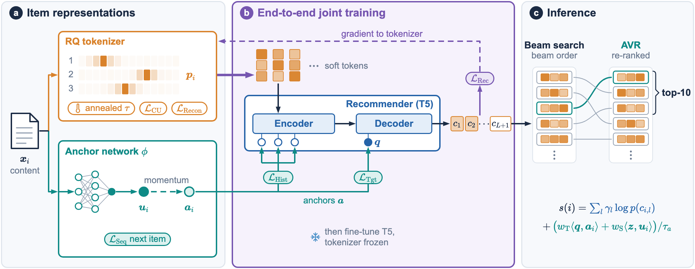

# UniGRec: Unified Generative Recommendation with Soft Identifiers and Dual Collaborative Anchoring

Official implementation of **UniGRec** (v2).

> The code of the previous version of this work ([arXiv:2601.17438](https://arxiv.org/abs/2601.17438)) remains available on the [`main`](https://github.com/Jialei-03/UniGRec/tree/main) branch.

---

## Introduction

Generative recommendation maps each item to a short sequence of codewords, its semantic identifier (SID), with an item tokenizer, and trains a recommender to generate the SID of the next item. We identify three problems that limit this paradigm:

- **Objective mismatch.** The tokenizer is pretrained or updated in alternation, mainly to reconstruct item content, and is never updated by the same recommendation loss in the same step as the recommender.
- **Identifier degradation.** Soft identifiers update every codeword in proportion to its assignment probability, so popular codewords absorb most updates and attract ever more items, collapsing many items onto shared identifiers.
- **Collaborative signal deficiency.** Identifiers derived from content and supervised token by token lack item-level collaborative signal.

UniGRec addresses them with:

- **Soft identifiers.** The recommender reads the tokenizer's codeword distributions instead of discrete codes, so one recommendation loss updates the tokenizer and the recommender together at every training step.
- **Codeword Uniformity Regularization** and **Annealed Inference Alignment**, which keep the soft identifiers distinct across items and consistent with the discrete codes.
- **Dual Collaborative Anchoring**, which learns item-level anchors from the item text embeddings by next-item prediction (without an item-ID table) and aligns the recommender's encoder and decoder with them, and **Anchor-Verified Re-ranking (AVR)**, which reuses the same anchors to re-rank the beam candidates.



Training has three stages:

1. **Tokenizer pretraining**: RQ-VAE (L=3 levels, K=256 codewords) with soft assignments, codeword uniformity regularization and a temperature annealed linearly from 0.01 to 0.001.
2. **End-to-end joint training**: `L_Joint = L_Rec + α L_Recon + λ_S L_Seq + 1[epoch > E_w] (λ_H L_Hist + λ_T L_Tgt)`. During the first `E_w = 20` epochs the tokenizer is frozen and the two alignment losses are off; the item-to-identifier map is recomputed from the current tokenizer at every step.
3. **Recommender fine-tuning** with the tokenizer and identifiers frozen.

Inference uses constrained beam search (width 30); AVR re-ranks the beam with weights fitted on the validation split.

---

## Installation

```bash
git clone https://github.com/Jialei-03/UniGRec.git
cd UniGRec
git checkout v2
conda create -n unigrec python=3.10 -y
conda activate unigrec
pip install -r requirements.txt
```

Experiment logging with [SwanLab](https://swanlab.cn) is optional: `pip install swanlab` and add `--use_swanlab` to the training commands.

---

## Data Preparation

Download the 2014 [Amazon Reviews](https://cseweb.ucsd.edu/~jmcauley/datasets/amazon/links.html) 5-core review file and the metadata file of a category into a directory, e.g. `raw/`:

```
raw/reviews_Beauty_5.json.gz          raw/meta_Beauty.json.gz
raw/reviews_Pet_Supplies_5.json.gz    raw/meta_Pet_Supplies.json.gz
```

Then build the leave-one-out splits and the 768-d sentence-T5 embeddings of the item titles and descriptions:

```bash
python dataset/preprocess_amazon.py --dataset Beauty --raw_dir raw/
python dataset/encode_items.py --data_dir dataset/Beauty      # sentence-transformers/sentence-t5-base
```

This produces

```
dataset/Beauty/
  train.parquet  valid.parquet  test.parquet   # columns: user, history, target
  item_emb_td.parquet                          # columns: ItemID (1..N), embedding
  item_text.jsonl  item_mapping.json  user_mapping.json
```

Users' interactions are sorted by time; the last item is the test target and the second-to-last the validation target. Training expands every prefix of each training sequence, and the trainer keeps the latest 20 interactions as history.

---

## Training and Evaluation

All scripts take the dataset name (`Beauty` or `Pet_Supplies`) as the first argument; paths default to `./dataset/<DATASET>` and `./checkpoints/...` and can be overridden with `DATA_DIR`, `RQVAE_PATH`, `CKPT_DIR` and `SAVE_DIR`. Extra arguments are passed on to the Python entry points.

```bash
# Stage 1: tokenizer pretraining -> checkpoints/Beauty-tokenizer/best_loss_model.pth
bash run_stage1_tokenizer.sh Beauty

# Stage 2 + 3: joint training, fine-tuning and test evaluation (beam order)
#   -> checkpoints/Beauty-UniGRec-s42/{best_model.pth, best_finetune_model.pth, results.json}
bash run_stage2_3_unigrec.sh Beauty 42

# Anchor-Verified Re-ranking: fit on validation, report test
#   -> checkpoints/Beauty-UniGRec-s42/avr/avr_results.json
bash run_avr.sh Beauty 42
```

The same hyperparameters are used for both datasets (see `run_stage2_3_unigrec.sh`): T5 with 6+6 layers, D=128, 4 heads, FFN 512; AdamW with learning rates 5e-3 (recommender), 2e-7 (tokenizer) and 1e-3 (anchoring module), weight decay 0.05, batch size 512, up to 200 joint epochs (patience 40); α=0.5, λ_S=0.05, λ_H=1.5, λ_T=0.05, τ_a=0.07, momentum 0.99; fine-tuning with a fresh AdamW, learning rate 2e-4 and linear decay (patience 10). Checkpoints are selected on validation NDCG@10.

Ablations of the paper are available as options of `model/train.py` (e.g. `--lambda_seq 0 --lambda_hist 0 --lambda_tgt 0` for w/o anchoring, `--freeze_tokenizer` for w/o joint training) and of `rqvae/main.py` (`--diversity_scale 0` for w/o codeword uniformity, `--temperature 0.001 --temperature_schedule none` for a constant temperature).

A CPU smoke test on a tiny synthetic dataset runs all stages end to end:

```bash
bash tests/smoke_test.sh
```

---

## Results

Test results (full ranking), mean over three training seeds (42, 2026, 2027). *w/o AVR* is the beam order reported by `run_stage2_3_unigrec.sh`; *UniGRec* includes AVR (`run_avr.sh`).

| Dataset | Method | R@10 | N@10 | R@20 | N@20 |
|---|---|---|---|---|---|
| Beauty | UniGRec w/o AVR | 0.0830 | 0.0466 | 0.1184 | 0.0554 |
| Beauty | UniGRec | **0.0866** | **0.0481** | **0.1221** | **0.0570** |
| Pet | UniGRec w/o AVR | 0.0718 | 0.0389 | 0.1053 | 0.0473 |
| Pet | UniGRec | **0.0754** | **0.0402** | **0.1093** | **0.0488** |

---

## Repository Structure

```
rqvae/                     stage 1: soft RQ-VAE tokenizer (main.py, trainer.py, models/)
model/
  unigrec.py               UniGRec model: tokenizer + soft-input T5 + anchoring
  t5.py                    T5 with probability-weighted encoder input, constrained beam search
  anchor.py                Dual Collaborative Anchoring (L_Seq, L_Hist, L_Tgt)
  train.py                 stage 2 (joint training) + stage 3 (fine-tuning) + test
  evaluation.py, data.py, utils.py
avr/                       Anchor-Verified Re-ranking (features, protocol, run_avr.py)
dataset/                   preprocess_amazon.py, encode_items.py
tests/                     synthetic-data smoke test
run_stage1_tokenizer.sh    run_stage2_3_unigrec.sh    run_avr.sh
```

---

## Citation

If you find this repository useful, please cite (previous version):

```bibtex
@misc{li2026unigrecunifiedgenerativerecommendation,
      title={UniGRec: Unified Generative Recommendation with Soft Identifiers for End-to-End Optimization},
      author={Jialei Li and Yang Zhang and Yimeng Bai and Shuai Zhu and Ziqi Xue and Xiaoyan Zhao and Dingxian Wang and Frank Yang and Andrew Rabinovich and Xiangnan He},
      year={2026},
      eprint={2601.17438},
      archivePrefix={arXiv},
      primaryClass={cs.IR},
      url={https://arxiv.org/abs/2601.17438},
}
```

---

## License

This project is released under the BSD 3-Clause License. See [LICENSE](LICENSE).
